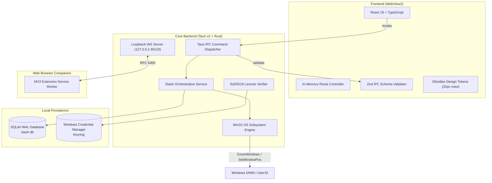

# Nakraku Stash

<div align="center">

```
  _   _       _                _            ____  _            _     
 | \ | | __ _| | ___ __ __ _| | ___   _   / ___|| |_ __ _ ___| |__  
 |  \| |/ _` | |/ / '__/ _` | |/ / | | |  \___ \| __/ _` / __| '_ \ 
 | |\  | (_| |   <| | | (_| |   <| |_| |   ___) | || (_| \__ \ | | |
 |_| \_|\__,_|_|\_\_|  \__,_|_|\_\\__,_|  |____/ \__\__,_|___/_| |_|
```

**Ultra-compact, high-density desktop workspace & window stashing engine for Windows 10/11.**  
*Freeze cluttered desktop sessions instantly. Reclaim RAM. Restore coordinates in milliseconds.*

[](LICENSE)
[](https://v2.tauri.app/)
[](https://www.rust-lang.org/)
[](https://react.dev/)
[](https://www.typescriptlang.org/)
[](docs/win32-api-surface.md)
[](docs/perf.md)

</div>

---

## Highlights

- **Instant Session Stashing**: Snapshot open application windows, process IDs, and virtual monitor coordinates with a single keystroke (`Ctrl+Shift+N`).
- **Sub-Second Restore**: Relaunches missing executables and restores exact pixel-perfect window placements (`SetWindowPos`, `WINDOWPLACEMENT`) in under `420 ms`.
- **Zero Elevated Privileges Required**: Full Win32 DWM interaction through unprivileged standard Windows user permissions without annoying UAC prompts.
- **Companion Browser Extension (MV3)**: Bridges Chrome, Edge, and Brave tabs via loopback WebSocket (`ws://127.0.0.1:48123`) to close tabs and restore active URLs seamlessly.
- **High-Density Desktop UI**: Built with Obsidian design tokens (`#080A0E`), 38px custom frameless titlebar, 32px monospace data rows, and zero bloated SaaS padding.
- **Offline Cryptographic Licensing**: Verified locally via asymmetric Ed25519 signatures. Free tier includes up to 3 workspaces; Pro tier unlocks unlimited workspaces with zero telemetry or network calls.
- **Embedded SQLite Storage**: Sessions and settings are saved locally to SQLite configured with Write-Ahead Logging (WAL) and memory-mapped I/O.
- **Lightweight Native Binary**: Core frontend payload is only **113.8 kB** (71.3% reduction via dynamic chunking), running atop a native Rust Win32 backend consuming under 22 MB idle RAM.

---

## Visual Architecture & Demo

<div align="center">
  
</div>

```
+---------------------------------------------------------------------------------------+
|  [#] Nakraku Stash   [Dashboard]  [Workspaces]  [Settings]   _   [ ]   [X] 38px Titlebar   |
+---------------------------------------------------------------------------------------+
|  LIVE WINDOWS (12)                                        RAM: 14.2 / 32.0 GB (44%)   |
|  -----------------------------------------------------------------------------------  |
|  [x] Visual Studio Code      Code.exe       PID 18420    1,248 MB    Display 1        |
|  [x] Windows Terminal        WindowsTerm... PID 9104       184 MB    Display 2        |
|  [x] Google Chrome (8 tabs)  chrome.exe     PID 14210    2,410 MB    Display 1        |
|  [x] Figma Desktop           Figma.exe      PID 22894      942 MB    Display 1        |
|  [ ] Spotify                 Spotify.exe    PID 11204      312 MB    Display 2        |
|  -----------------------------------------------------------------------------------  |
|  [ + STASH WORKSPACE (Ctrl+Shift+N) ]            [ RESTORE LAST (Ctrl+Shift+R) ]      |
+---------------------------------------------------------------------------------------+
|  Status: Local WS Connected (Port 48123) | SQLite WAL Active | License: Pro Perpetual  |
+---------------------------------------------------------------------------------------+
```

---

## System Requirements

- **Operating System**: Windows 10 (Build 19041+) or Windows 11 (x64)
- **Runtime**: [Microsoft Edge WebView2 Runtime](https://developer.microsoft.com/en-us/microsoft-edge/webview2/) (pre-installed on Windows 10/11)
- **RAM**: Minimum 50 MB free RAM (application typically consumes ~22 MB native / ~64 MB WebView2)
- **Disk Space**: ~35 MB for installed binaries and SQLite storage

---

## Installation

### Standard Windows Installer (NSIS)
Download the latest `Nakraku-Stash-Setup-x64.exe` from [Releases](https://github.com/nakraku/stash/releases).
- Installs per-user into `%LOCALAPPDATA%\Programs\Nakraku Stash` without requiring Administrator rights.
- Creates Start Menu shortcut and optional desktop icon.
- Automatically handles background updates via Ed25519 verified manifests.

### Enterprise MSI Package
For domain-managed deployments and Group Policy automation:
```powershell
msiexec /i Nakraku-Stash-x64.msi /quiet /qn /norestart
```

### Browser Extension Companion (Chrome / Edge / Brave)
1. Download `dist-extension.zip` from the release assets or build via `npm run build:extension`.
2. Open your browser's extension manager (`chrome://extensions` or `edge://extensions`).
3. Toggle **Developer mode** on (top-right switch).
4. Click **Load unpacked** and select the unzipped `extension/` directory.

---

## Keyboard Shortcuts

| Shortcut | Context | Action |
|---|---|---|
| `Ctrl+Shift+N` | Global (OS-wide) | Immediately snapshot and stash the active workspace session |
| `Ctrl+Shift+R` | Global (OS-wide) | Restore the most recent stashed session |
| `Ctrl+K` | Application | Open the high-density Command Palette |
| `Ctrl+,` | Application | Open the Settings view |
| `Ctrl+1` | Application | Switch to Dashboard view |
| `Ctrl+2` | Application | Switch to Workspaces view |
| `Escape` | Modals / Palette | Dismiss open dialog, modal, or command search |
| `Enter` | Modal / Row | Confirm action or restore selected workspace |

---

## Architecture Overview

Nakraku Stash is built with a decoupled three-tier desktop architecture:



For comprehensive subsystem deep-dives, see [`docs/ARCHITECTURE.md`](docs/ARCHITECTURE.md).

---

## Building from Source

### Prerequisites
1. **Node.js**: v20.x or higher with `npm` v10+
2. **Rust**: v1.77+ (`rustup default stable-x86_64-pc-windows-msvc`)
3. **C++ Build Tools**: Visual Studio Build Tools 2022 with Desktop development with C++
4. **Tauri CLI v2**: Included via project devDependencies (`@tauri-apps/cli`)

### Quick Setup

```powershell
# 1. Clone the repository
git clone https://github.com/nakraku/stash.git
cd stash

# 2. Install frontend and build toolchain dependencies
npm install

# 3. Verify environment prerequisites
powershell -ExecutionPolicy Bypass -File scripts/check-env.ps1

# 4. Run frontend and Rust backend in concurrent dev mode
npm run dev
# or launch desktop window directly
npm run tauri:dev
```

### Build & Package Artifacts

```powershell
# Production compile of frontend bundle and browser extension
npm run build
npm run build:extension

# Build standalone NSIS installer and MSI packages
npm run tauri:build
```

---

## Testing & Quality Assurance

Nakraku Stash maintains strict zero-tolerance quality gates:

```powershell
# Run ultra-fast Oxlint across all TypeScript files
npm run lint

# TypeScript strict typecheck (zero any allowed)
npm run check

# PowerShell anti-slop guardrail scan
powershell -ExecutionPolicy Bypass -File scripts/guardrails.ps1

# Frontend Vitest suite (34 suites, 169 tests)
npm test

# Native Rust unit & integration test runner (27 tests)
npm run test:rust

# Performance regression gate (asserts JS bundle < 200 kB, diff latency < 15 ms)
npm run perf:gate

# Run complete CI battery locally
npm run ci:all
```

---

## Privacy & Security Philosophy

1. **Zero Cloud Telemetry**: Nakraku Stash makes **zero outbound internet network calls** during normal operation. All snapshots, window titles, process telemetry, and settings remain strictly on your local machine.
2. **Loopback Only WebSocket**: The internal extension bridge binds exclusively to `127.0.0.1:48123`. Incoming connections are verified against browser extension origin schemes (`chrome-extension://*`, `moz-extension://*`).
3. **Local Machine Cryptography**: Licenses are verified offline via asymmetric Ed25519 digital signatures. No license check requests are ever transmitted to an external server.
4. **Hardware ID Privacy**: The hardware fingerprint is generated via a cryptographically salted SHA-256 hash of hardware identifiers. Raw serial numbers or PII are never persisted.

Read our complete threat model and disclosure policy in [`docs/SECURITY.md`](docs/SECURITY.md).

---

## Documentation Index

- [Architecture Specification](docs/ARCHITECTURE.md) — Complete IPC, DB, and process lifecycle documentation
- [Win32 API Surface Specification](docs/win32-api-surface.md) — FFI signatures, User32/Kernel32 invariants, and coordinate mapping
- [WebSocket Protocol Specification](docs/ws-protocol.md) — Browser companion envelope, tab stash/restore messages
- [Database Schema Specification](docs/schema.md) — SQLite WAL schema, tables, indexes, and migrations
- [Offline Licensing Specification](docs/license-spec.md) — Ed25519 signature format and key verification rules
- [Performance & Optimization Report](docs/perf.md) — Bundle benchmarks, memory usage, and latency baselines
- [Security Threat Model](docs/SECURITY.md) — Security policies, allowlists, and origin validation
- [CI/CD & Branch Protection](docs/CI-CD.md) — GitHub Actions pipeline and regression gates
- [Installer & Code Signing](docs/DISTRIBUTION.md) — Packaging, dual timestamping, and update manifests
- [Bug Triage & Edge Cases](docs/BUGS.md) — Active edge-case mitigation log

---

## Contributing

We welcome contributions! Please review our [`CONTRIBUTING.md`](CONTRIBUTING.md) guide before submitting pull requests.

## License

This project is licensed under the MIT License — see the [`LICENSE`](LICENSE) file for details.
