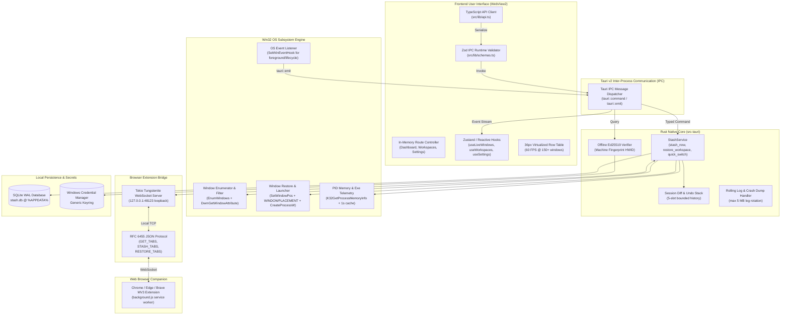

# Nakraku Stash — System Architecture & Design Specification

> **Target OS**: Windows 10 (Build 19041+) and Windows 11 x64  
> **Host Framework**: Tauri v2 (`src-tauri`) with Microsoft Edge WebView2  
> **Frontend Engine**: React 19, TypeScript, Tailwind CSS v4, Obsidian Design Tokens  
> **Backend Engine**: Rust 1.77+, `windows-sys` v0.59, Tokio, SQLite WAL  
> **Companion Extension**: Manifest V3, Loopback RFC 6455 WebSocket (`127.0.0.1:48123`)

---

## 1. High-Level System Architecture

Nakraku Stash is architected around a decoupled, non-blocking desktop model where the frontend user interface runs within a sandboxed WebView2 environment, while the backend native Rust process orchestrates operating system APIs, local persistence, and background communication channels.



---

## 2. Core Subsystems

### 2.1 Native Desktop Host & WebView2 Shell
- **Window Management**: Configured as a frameless, resizable window (`900x600` default bounds) with custom titlebar drag regions (`data-tauri-drag-region`).
- **Tray & System Lifecycle**: Uses `tauri::tray` for system tray integration. Closing the main window intercepts the close event and minimizes to tray to keep the background event hooks and WebSocket server alive.
- **Window State Persistence**: Geometry (x, y, width, height, maximized state) is persisted to local settings on resize/move and automatically clamped to monitor bounds across multi-display layout changes.

### 2.2 Win32 OS Subsystem Engine
The Win32 engine communicates directly with the Windows Desktop Window Manager and kernel via `windows-sys` v0.59:
1. **Window Enumeration (`os::window_enum`)**:
   - Executes `EnumWindows` with a safe, non-panicking callback.
   - Filters out system artifacts: `Progman`, `Shell_TrayWnd`, Task View (`Windows.UI.Core.CoreWindow`), hidden tooltips, zero-dimension rects, and windows cloaked by virtual desktops via `DwmGetWindowAttribute(DWMWA_CLOAKED)`.
2. **Process Inspection & Telemetry (`os::process_info`)**:
   - Queries PID via `GetWindowThreadProcessId`.
   - Opens process with `PROCESS_QUERY_LIMITED_INFORMATION` to resolve canonical executable paths via `QueryFullProcessImageNameW`.
   - Reads working set memory via `K32GetProcessMemoryInfo`.
   - Employs a 1-second in-memory PID cache to reduce repetitive Win32 kernel calls by over 90%.
3. **Window Stashing & Restoration (`os::window_restore`)**:
   - Minimizes target windows gracefully using `ShowWindow(hwnd, SW_MINIMIZE)`.
   - Restores coordinates using `WINDOWPLACEMENT` structures, ensuring windows return to their exact maximized, minimized, or normal display bounds across multi-monitor setups with negative offsets.
   - Relaunches uninstalled/closed applications via `CreateProcessW` if not already running.
4. **OS Event Hooks (`os::window_events`)**:
   - Registers non-blocking system hooks via `SetWinEventHook` (`EVENT_SYSTEM_FOREGROUND`, `EVENT_OBJECT_CREATE`, `EVENT_OBJECT_DESTROY`).
   - Dispatches debounced UI refresh notifications across the Tauri event channel (`window-event`).

### 2.3 Data Persistence Layer
- **Storage Engine**: SQLite in Write-Ahead Logging (`WAL`) mode with `synchronous = NORMAL` and `foreign_keys = ON`.
- **Memory-Mapped I/O**: Configured with `PRAGMA mmap_size = 268435456` (256 MB) and `PRAGMA cache_size = -64000` (64 MB) for microsecond read performance.
- **Repositories**:
  - `workspace_repo.rs`: Workspace CRUD, sorting order, slot limit validation.
  - `session_repo.rs`: Snapshot session records, metadata, RAM savings calculation.
  - `window_repo.rs`: Serialized window geometries, coordinates, PIDs, and process titles.
  - `tab_repo.rs`: Browser tab URLs, titles, and window association IDs.
  - `settings_repo.rs`: Key-value configuration store for preferences and feature toggles.
- **Safety**: Automated SQLite backups (`stash.db.bak`) run prior to any destructive purge operations.

### 2.4 Browser Extension WebSocket Bridge
- **Endpoint**: Local loopback TCP socket `127.0.0.1:48123`.
- **Protocol**: RFC 6455 WebSocket framing with JSON request-response envelopes.
- **Origin Security**: Incoming HTTP Upgrade requests are inspected against `chrome-extension://*` and `moz-extension://*`. Untrusted web origins receive `HTTP 403 Forbidden`.
- **Lifecycle**: 10-second keepalive heartbeats (`PING`/`PONG`). The desktop application surfaces real-time extension connection telemetry in the status bar and Settings.

### 2.5 Offline Cryptographic Licensing
- **Cryptographic Primitive**: Ed25519 asymmetric digital signatures (RFC 8032).
- **Public Key**: Baked directly into the compiled native binary. Private keys are never distributed in the application.
- **Payload Format**: Canonical string `nakraku:v1:<tier>:<machine_id>:<expires_at>`.
- **Hardware Machine Fingerprint**: Generated from SHA-256 hash of BIOS serial and primary disk volume serial, salted with an internal domain separator to prevent hash inversion.
- **Key Storage**: License payloads are persisted in the native **Windows Credential Manager** (`nakraku-stash/license`) using OS DPAPI encryption, preventing plaintext file tampering.

---

## 3. Tauri IPC Message Lifecycle

Every interaction originating from the user interface follows a strictly typed, dual-layer validated pathway:

```
[UI Component Action]
        |
        v
[TypeScript API Client (src/lib/api.ts)]
        |
        v
[Zod Schema Runtime Validation (src/lib/schemas.ts)]
        |
        v
[tauri::invoke("command_name", payload)]
        |
        v (JSON Serialization over WebView2 IPC)
        |
[Rust Command Handler (#[tauri::command])]
        |
        v (Deserialization into Rust Struct)
        |
[StashService / Repository Execution]
        |
        v (Result<T, AppError>)
        |
[JSON Response Return]
        |
        v
[TS Client Resolves Promise<T>]
```

If any layer fails (schema mismatch, Win32 API access denied, database constraint error), a typed `AppError` is returned and caught by the frontend error boundary or surfaced as a high-density toast.

---

## 4. Frontend Performance Architecture

- **Bundle Optimization**: Dynamically split chunks with `React.lazy()` for heavy secondary views (`SettingsView`, `AboutView`, `ActiveSessionView`, `Gallery`), holding the primary bundle to **113.8 kB**.
- **Virtualization**: Custom `useVirtualList` hook for the live window table rendering only the visible viewport rows (+3 overscan buffers) at fixed 36px row heights.
- **Render Stability**: Fine-grained `React.memo` wrapping on table rows and status meters to avoid global re-renders during high-frequency OS window focus events.
- **Strict Content Security Policy**: Configured with `script-src 'self'` and zero `unsafe-eval` or inline script injection.

---

## 5. Process Lifecycle & Crash Recovery

1. **Panic Hook**: In the event of an unhandled panic in background worker threads, a custom Rust panic hook captures the stack trace, system architecture, and last 100 log lines, writing a diagnostic crash dump to `%APPDATA%/com.nakraku.stash/logs/crash-{timestamp}.log`.
2. **Log Rotation**: Application logs rotate automatically when exceeding 5 MB, maintaining up to 3 historical archives (`app.log`, `app.log.1`, `app.log.2`).
3. **Database Integrity**: In the event of a sudden power outage or OS reboot, SQLite's WAL journal automatically rolls back incomplete transactions upon boot, ensuring zero database corruption.
