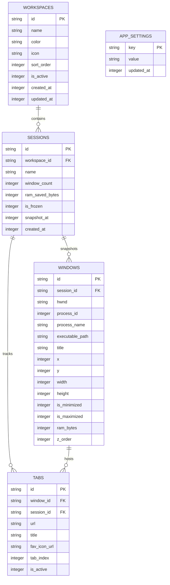

# Nakraku Stash — Database Schema v1

## 1. Overview
Nakraku Stash uses an embedded SQLite database (`stash.db`) located in the platform-specific Application Data directory:
* **Windows**: `%APPDATA%\com.nakraku.stash\stash.db`
* **Journal Mode**: `WAL` (Write-Ahead Logging) for concurrent reads/writes and crash resilience.
* **Foreign Keys**: Enforced via `PRAGMA foreign_keys = ON;`.

---

## 2. Entity-Relationship Diagram (ERD)

---

## 3. Tables & Schema Definitions

### `workspaces`
Represents an isolated user context (e.g. "Work", "Personal", "Research"). Free tier is restricted to 3 active workspaces.
* `id` (`TEXT PRIMARY KEY`): Unique UUIDv4 string identifier.
* `name` (`TEXT NOT NULL`): Human-readable workspace name.
* `color` (`TEXT NOT NULL DEFAULT '#10B981'`): Hex color identifier for UI badges and border accents.
* `icon` (`TEXT DEFAULT 'workspace'`): Icon identifier string from system icon registry.
* `sort_order` (`INTEGER NOT NULL DEFAULT 0`): Ordering integer for drag-and-drop sequencing.
* `is_active` (`INTEGER NOT NULL DEFAULT 0`): Boolean flag indicating current workspace.
* `created_at` (`INTEGER NOT NULL`): Unix epoch millisecond timestamp.
* `updated_at` (`INTEGER NOT NULL`): Unix epoch millisecond timestamp.

### `sessions`
Point-in-time snapshots of running desktop applications and open browser windows.
* `id` (`TEXT PRIMARY KEY`): Unique UUIDv4 string identifier.
* `workspace_id` (`TEXT NOT NULL`): Foreign key referencing `workspaces(id)` on delete cascade.
* `name` (`TEXT NOT NULL`): Snapshot name (e.g. "Auto-Snapshot 09:30").
* `window_count` (`INTEGER NOT NULL DEFAULT 0`): Number of windows captured in this snapshot.
* `ram_saved_bytes` (`INTEGER NOT NULL DEFAULT 0`): Estimated memory freed in bytes.
* `is_frozen` (`INTEGER NOT NULL DEFAULT 1`): Boolean indicating whether processes are currently suspended.
* `snapshot_at` (`INTEGER NOT NULL`): Unix epoch millisecond timestamp of capture.
* `created_at` (`INTEGER NOT NULL`): Unix epoch millisecond timestamp.

### `windows`
Individual top-level Win32 desktop application windows.
* `id` (`TEXT PRIMARY KEY`): Unique UUIDv4 string identifier.
* `session_id` (`TEXT NOT NULL`): Foreign key referencing `sessions(id)` on delete cascade.
* `hwnd` (`TEXT NOT NULL`): Hexadecimal Win32 HWND handle string (e.g. `0x0014023A`).
* `process_id` (`INTEGER NOT NULL`): Win32 PID (Process Identifier).
* `process_name` (`TEXT NOT NULL`): Executable binary name (e.g. `Code.exe`).
* `executable_path` (`TEXT`): Full disk path to binary for re-launching.
* `title` (`TEXT NOT NULL`): Window caption bar text.
* `x`, `y` (`INTEGER NOT NULL`): Screen pixel coordinates.
* `width`, `height` (`INTEGER NOT NULL`): Window dimensions in pixels.
* `is_minimized` (`INTEGER NOT NULL DEFAULT 0`): Boolean window state flag.
* `is_maximized` (`INTEGER NOT NULL DEFAULT 0`): Boolean window state flag.
* `ram_bytes` (`INTEGER NOT NULL DEFAULT 0`): Process Working Set memory size in bytes.
* `z_order` (`INTEGER NOT NULL DEFAULT 0`): Desktop layering index.

### `tabs`
Browser tabs captured via MV3 companion extension through the local WebSocket bridge.
* `id` (`TEXT PRIMARY KEY`): Unique UUIDv4 string identifier.
* `window_id` (`TEXT NOT NULL`): Foreign key referencing `windows(id)` on delete cascade.
* `session_id` (`TEXT NOT NULL`): Foreign key referencing `sessions(id)` on delete cascade.
* `url` (`TEXT NOT NULL`): Web page URI.
* `title` (`TEXT NOT NULL`): Browser tab title.
* `fav_icon_url` (`TEXT`): Favicon URL or base64 data.
* `tab_index` (`INTEGER NOT NULL DEFAULT 0`): Tab position index within browser window.
* `is_active` (`INTEGER NOT NULL DEFAULT 0`): Boolean indicating if tab was focused.

### `app_settings`
Persistent application settings key-value store.
* `key` (`TEXT PRIMARY KEY`): Identifier string (e.g. `autostart`, `min_to_tray`, `license_key`).
* `value` (`TEXT NOT NULL`): JSON stringified value.
* `updated_at` (`INTEGER NOT NULL`): Unix epoch millisecond timestamp.
